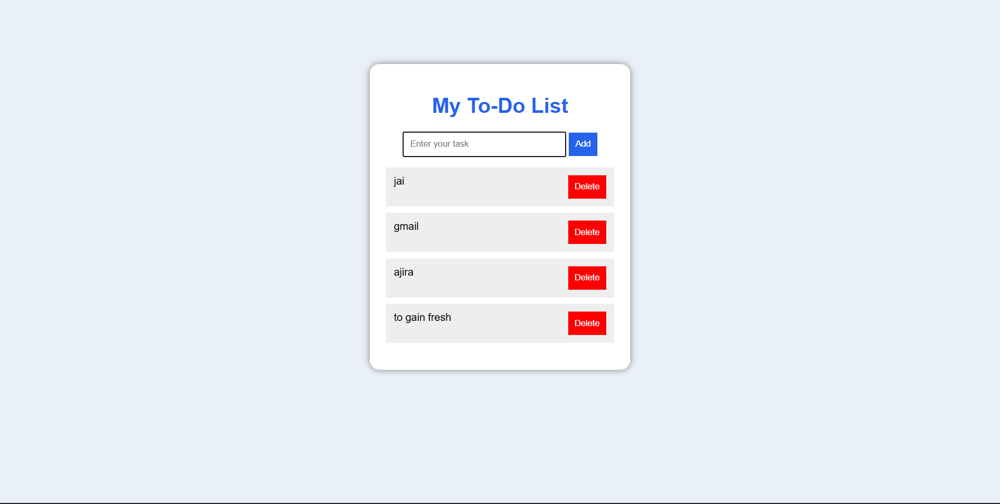

# Todolist
## Aim
To design and develop a To-Do List website using HTML, CSS, and JavaScript to add, complete, and delete daily tasks.
## Algorithm
1. Start the program.
2. Create a webpage using HTML.
3. Design the webpage using CSS.
4. Create an input box to enter tasks.
5. Click the Add button to add a new task.
6. Display the task in the list.
7. Click the task to mark it as completed.
8. Click the Delete button to remove the task.
9. Stop the program.
## Code
```
<!DOCTYPE html>
<html>
<head>
    <title>My To-Do List</title>

    <style>
        body {
            font-family: Arial;
            background: #eaf0f8;
            text-align: center;
        }

        .container {
            background: white;
            width: 350px;
            margin: 100px auto;
            padding: 25px;
            border-radius: 15px;
            box-shadow: 0 0 10px gray;
        }

        h1 {
            color: #2563eb;
        }

        input {
            padding: 10px;
            width: 65%;
        }

        button {
            padding: 10px;
            background: #2563eb;
            color: white;
            border: none;
            cursor: pointer;
        }

        ul {
            padding: 0;
        }

        li {
            list-style: none;
            background: #eee;
            padding: 12px;
            margin-top: 10px;
            display: flex;
            justify-content: space-between;
        }

        .delete {
            background: red;
        }

        .completed {
            text-decoration: line-through;
            color: gray;
        }
    </style>
</head>

<body>

    <div class="container">

        <h1>My To-Do List</h1>

        <input type="text" id="task" placeholder="Enter your task">

        <button onclick="addTask()">Add</button>

        <ul id="list"></ul>

    </div>

    <script>
        function addTask() {

            var task = document.getElementById("task").value;

            if (task == "") {
                alert("Please enter a task");
                return;
            }

            var li = document.createElement("li");

            var span = document.createElement("span");
            span.innerHTML = task;

            span.onclick = function() {
                span.classList.toggle("completed");
            };

            var btn = document.createElement("button");
            btn.innerHTML = "Delete";
            btn.className = "delete";

            btn.onclick = function() {
                li.remove();
            };

            li.appendChild(span);
            li.appendChild(btn);

            document.getElementById("list").appendChild(li);

            document.getElementById("task").value = "";
        }
    </script>

</body>
</html>
```
# Output
](image.png)
## Result
Thus, the To-Do List website was successfully created and executed using HTML, CSS, and JavaScript.v